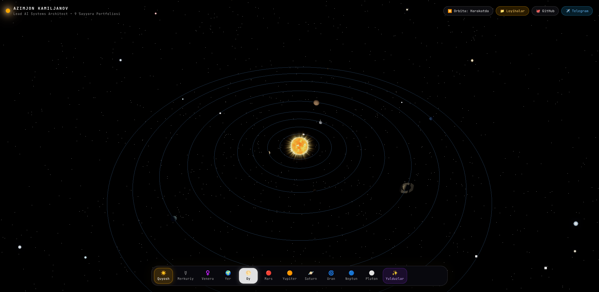

# 🪐 3D Solar System Developer Portfolio

> **Azimjon Kamiljanov** — Lead AI Systems Architect & Senior Full-Stack Engineer  
> 🌐 **Live Website:** [https://azimjon.dev](https://azimjon.dev)



---

## 🌌 Overview

An immersive, hyper-realistic, interactive 3D WebGL Solar System portfolio showcasing large-scale AI ecosystems, cybersecurity defense platforms, and full-stack software architectures. Designed with an ultra-minimalist, serious executive aesthetic and powered by GPU-accelerated shaders.

---

## ✨ Key Features

- **☀️ Hyper-Realistic Convective Sun:** NASA SDO AIA photosphere, 3D simplex domain-warped procedural boiling magma/lava core, dynamic solar prominence arches, and soft coronal streamers.
- **🪐 All 9 Concentric Planetary Portals:** Mercury, Venus, Earth + Moon, Mars, Jupiter, Saturn (with rings), Uranus (with rings at 97.8° axial tilt), Neptune, and Pluto orbiting collision-free with authentic Keplerian mechanics.
- **🛸 1,450+ Instanced Asteroid Belt:** Procedurally distributed rocky asteroid ring between Mars and Jupiter rendered via Three.js `InstancedMesh` at a locked 60 FPS.
- **🤖 Real-time AI Vision Gesture Control:** Powered by MediaPipe Hands. Navigate the cosmos using hand gestures through your webcam (Open Palm to Orbit, Pointing for Crosshair Reticle, Pinch to Zoom/Select, Fist to Freeze).
- **🎬 Cinematic Autopilot Tour Mode:** Smooth Bézier camera transitions guiding visitors sequentially through the Sun, all 9 planets, and lunar satellite with floating telemetry HUD and playback controls.
- **💬 Direct AI Telegram Terminal (The Moon):** In-scene cyber terminal enabling visitors to transmit encrypted dispatches directly to Azimjon's Telegram Bot (`@CyberAgent0bot`) with VoIP call integration (`@CyberAgentNexus`).
- **📄 1-Tap PDF Resume / CV Download:** Instant high-resolution executive resume access directly from the header and Sun modal.
- **🌐 Trilingual Engine:** Full live language switching across Uzbek (UZ), English (EN), and Russian (RU) with 100% state retention.
- **📱 Responsive & Liquid Glass UI:** Ultra-clean frosted glass HUD docks, 0px horizontal overflow across all viewports from 390px mobile screens to 4K displays.

---

## 🛠️ Technology Stack

- **3D & Graphics Engine:** Three.js (r160), WebGL, Custom GLSL Shaders, EffectComposer, ACESFilmicToneMapping, UnrealBloomPass.
- **Computer Vision:** MediaPipe Hands Lite, Camera Utils.
- **Animations:** GSAP (GreenSock), Cubic Bézier interpolation.
- **Audio:** Web Audio API Procedural Synthesizer & Spatial Ambient Soundscape.
- **Architecture:** Zero-dependency vanilla ES Modules, pure CSS3 frosted liquid glass, Telegram Bot API Uplink.

---

## 🚀 Local Development

Clone the repository and serve with any local HTTP server:

```bash
# Clone repository
git clone https://github.com/AzimjonKamiljanov/azimjon-portfolio-3d.git
cd azimjon-portfolio-3d

# Start local server (Python)
python3 -m http.server 8080

# Or using Node.js
npx serve .
```

Visit `http://localhost:8080` in any WebGL-capable browser.

---

## 📜 License

Created by **Azimjon Kamiljanov**. All rights reserved.
