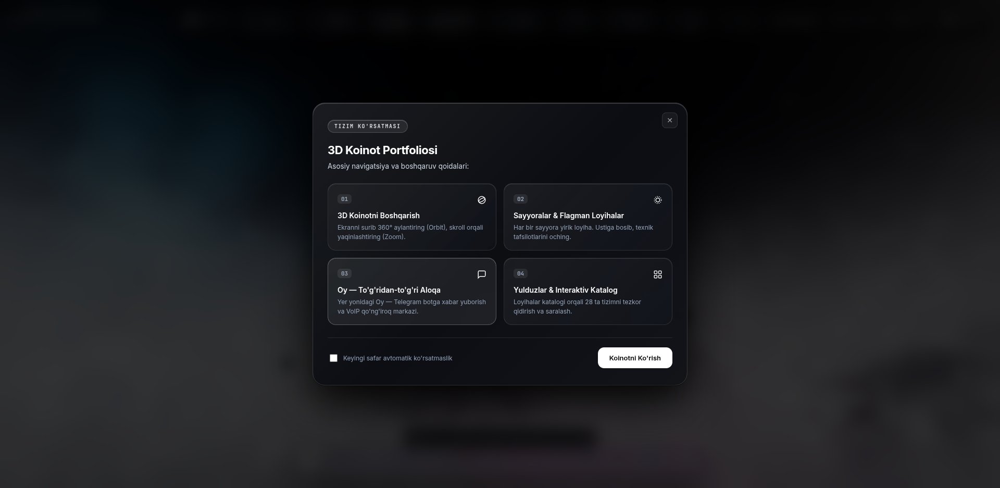

# 🪐 3D Solar System Developer Portfolio

> **Azimjon Kamiljanov** — AI & Full-Stack Developer (Student)  
> 🎓 2nd-year AI Student at **PDP University** • Cybersecurity Student at **School 21 Tashkent**  
> 🌐 **Live Site:** [https://azimjon.dev](https://azimjon.dev)



---

## 🌌 Overview

An interactive, high-performance 3D WebGL Solar System portfolio showcasing AI ecosystems, software architectures, and cybersecurity tooling. Powered by Three.js and deployed globally on Cloudflare Workers with strict Content Security Policy (CSP), zero external CDNs, self-hosted assets, and automated end-to-end verification.

---

## ✨ Key Features

- **☀️ Photorealistic Convective Sun:** NASA SDO AIA photosphere, 3D simplex domain-warped procedural boiling lava core, dynamic solar prominence arches, and soft coronal streamers.
- **🪐 All 9 Concentric Planetary Portals:** Mercury, Venus, Earth + Moon, Mars, Jupiter, Saturn (with rings), Uranus (with rings at 97.8° axial tilt), Neptune, and Pluto orbiting collision-free with authentic Keplerian mechanics.
- **🛸 1,450+ Instanced Asteroid Belt:** Procedurally distributed rocky asteroid ring between Mars and Jupiter rendered via Three.js `InstancedMesh` at a locked 60 FPS.
- **🤖 Computer Vision Hand Control:** Self-hosted Google MediaPipe Hands, lazy-loaded on demand behind an explicit privacy consent modal. The webcam is a complete input device, not a demo of a few poses — eleven gestures cover open, navigate, select, scroll and close, so nothing requires falling back to a mouse:

  | Gesture        | Action                                                          |
  | -------------- | --------------------------------------------------------------- |
  | 🖐 Open palm   | Orbit; flick to change planet; hold still to reset the view     |
  | 👆 Point       | Crosshair reticle with a visible dwell ring before it selects   |
  | 🤏 Pinch       | Tap to select; drag sideways for precise orbit, up/down to zoom |
  | 👐 Two hands   | Spread to zoom, rotate the pair to roll the camera              |
  | ✊ Fist        | Freeze orbital time                                             |
  | ✌️ Victory     | Hold for the tour; move up/down to scroll the open panel        |
  | 👍 Thumbs up   | Hyper-speed (3x / 1x)                                           |
  | 👎 Thumbs down | Close the top panel / go back                                   |
  | 👌 OK          | Project catalog                                                 |
  | 🤙 Shaka       | Contact terminal                                                |
  | 🤘 Horns       | Astronomical scale                                              |

  Every hold action fills a progress bar and every dwell fills a ring, so the
  wait is never mistaken for a dead control. Sensitivity, dwell time, hold
  time, deadzone and mirroring are adjustable in the HUD and remembered per
  visitor — fixed thresholds cannot suit every webcam, room and arm reach.

- **🎬 Cinematic Autopilot Tour Mode:** Smooth Bézier camera transitions guiding visitors sequentially through the Sun, all 9 planets, and lunar satellite with floating telemetry HUD and playback controls.
- **💬 Direct Contact Terminal (The Moon):** In-scene cyber terminal that transmits messages to a Telegram bot, protected by a honeypot, a Cloudflare edge rate limiter, and — when configured — a Cloudflare Turnstile challenge. The challenge is driven entirely at runtime from `GET /api/config`, so the widget and the Worker's verification can never disagree about whether it is active.
- **📄 Clean PDF Resume / CV Download:** Instant high-resolution resume access directly from the header and Sun modal without browser print headers or footers.
- **🌐 Trilingual Engine:** Full live language switching across Uzbek (UZ), English (EN), and Russian (RU) with 100% state retention.
- **📱 Responsive & Liquid Glass UI:** Frosted glass HUD docks, 0px horizontal overflow across all viewports from 375px mobile screens to 4K displays.
- **🔍 SEO & Prerendered Catalog:** Pre-rendered semantic HTML fallback for search engines and screen readers; instant debounced search across all 28 catalog items.

---

## 🛠️ Technology Stack

- **Frontend & 3D:** [Three.js](https://threejs.org/) (r186), WebGL, Custom GLSL Shaders, EffectComposer, UnrealBloomPass, [GSAP](https://greensock.com/gsap/).
- **Build System:** [Vite 6](https://vitejs.dev/) with vanilla ES modules, code splitting, and tree shaking.
- **Deployment & Serverless:** [Cloudflare Workers](https://workers.cloudflare.com/) (`worker.js`) serving static assets from `./dist` with strict security headers.
- **Typography:** Self-hosted [`@fontsource`](https://fontsource.org/) (Inter, Plus Jakarta Sans, JetBrains Mono).
- **Vision:** Self-hosted Google MediaPipe Hands (WASM + TFLite models).
- **Audio:** Web Audio API Procedural Synthesizer & 64 kbps ambient soundscape.
- **Testing:** [Vitest](https://vitest.dev/) (unit tests) & [Playwright](https://playwright.dev/) (browser E2E acceptance tests).
- **Code Quality:** ESLint v10 flat config with per-runtime globals, Prettier, GitHub Actions CI with a blocking secret scan.

---

## 📁 Repository Structure

```
├── .github/workflows/       # GitHub Actions automated CI pipeline
├── assets/                  # Texture *sources* (JPG/PNG) — never shipped; see note below
├── docs/screenshots/        # Verification and portfolio screenshots
├── public/                  # Served as-is: favicons, manifests, MediaPipe WASM, WebP textures
├── scripts/                 # Offline build utilities (texture generators, resume PDF, prerender)
├── src/
│   ├── audio/               # Web Audio API procedural soundscape
│   ├── bodies/              # 3D bodies: Sun, 9 planets, asteroid belt, stars, cosmic objects
│   ├── data/                # Single source of truth: profile.json, projects.json
│   ├── i18n/                # Trilingual dictionary and dynamic language switcher
│   ├── input/               # OrbitControls, camera Bézier transitions, raycaster, gestures
│   ├── scene/               # Canvas, camera, renderer with DPR clamp, bloom postprocessing
│   ├── styles/              # Design tokens and the shared refinement layer
│   ├── ui/                  # HUD docks, focus-trapped modals, catalog, tour, Moon terminal
│   ├── errors.js            # Centralized client-side error telemetry
│   └── main.js              # Application entry point
├── tests/                   # Vitest unit tests and Playwright E2E test suite
├── worker.js                # Hardened Cloudflare Worker backend (/api/contact)
├── wrangler.jsonc           # Cloudflare Worker configuration (serving ./dist)
├── vite.config.js           # Vite 6 configuration with manual chunking
└── vitest.config.js         # Vitest test configuration
```

> **On `assets/` vs `public/assets/`:** the runtime loads `assets/*.webp`,
> which resolves to **`public/assets/`**. The top-level `assets/` directory
> holds the 6.3 MB of JPG/PNG that `scripts/optimize_assets.mjs` converts into
> those WebP files — intermediate build input, never served. It is kept in the
> repository because it is the only copy of the generated textures.
>
> Untracking it would not shrink a clone, since the blobs remain in history;
> only a history rewrite (`git filter-repo`, or Git LFS via `git lfs migrate`)
> followed by a force-push would. That trade — a smaller clone against
> breaking every existing clone and fork — is a deliberate choice, not an
> oversight.

---

## 🚀 Quick Start

### Prerequisites

- Node.js ≥ 20.0.0
- npm ≥ 10.0.0

### Installation & Development

```bash
# Clone repository
git clone https://github.com/AzimjonKamiljanov/azimjon-portfolio-3d.git
cd azimjon-portfolio-3d

# Install dependencies
npm install

# Start local development server (http://localhost:8080)
npm run dev
```

### Production Build & Preview

```bash
# Build production bundle into dist/
npm run build

# Preview production build locally
npm run preview
```

### Automated Testing & Linting

```bash
# Unit and dist-integrity tests (Vitest) - 67 tests
npm test

# Browser E2E acceptance tests (Playwright)
npm run test:e2e

# Functional E2E only, skipping the machine-specific visual baselines
npm run test:e2e:functional

# Lint the whole repo (ESLint flat config, per-runtime globals)
npm run lint

# Check formatting
npm run format:check

# Everything CI's quality job runs, in one command
npm run verify
```

### CI

`.github/workflows/ci.yml` runs four jobs on every push and pull request:

| Job        | What it gates                                                      |
| ---------- | ------------------------------------------------------------------ |
| `quality`  | Prettier, ESLint, production build, Vitest                         |
| `e2e`      | Playwright functional specs on headless Chromium                   |
| `visual`   | Visual regression - advisory, since baselines are machine-specific |
| `security` | `npm audit` on production deps, plus a full-history Gitleaks scan  |

The secret scan **fails the build** on any finding, and also when the scanner
writes no report at all - a crashed scanner must not read as a clean tree.

---

## 🔐 Environment Variables & Deployment

Create a `.dev.vars` file for local Worker testing (see `.dev.vars.example`):

```bash
TELEGRAM_BOT_TOKEN="your_bot_token_here"
TELEGRAM_CHAT_ID="your_telegram_chat_id"
ENVIRONMENT="dev"

# Turnstile is optional, but BOTH keys are required together.
TURNSTILE_SITE_KEY="optional_turnstile_public_site_key"
TURNSTILE_SECRET_KEY="optional_turnstile_secret_key"
```

> **On Turnstile:** the Worker treats the challenge as active only when it
> holds both keys, and publishes the public site key to the browser from
> `GET /api/config`. Setting just one logs an error and leaves the challenge
> off rather than rejecting every message. While it is off, no external
> origin appears in the Content-Security-Policy at all; the Turnstile origin
> is added to `script-src`, `frame-src` and `connect-src` only when the
> challenge is actually live.

To configure secrets in Cloudflare Workers and deploy:

```bash
# Store production values (one prompt each; nothing is echoed)
npx wrangler secret put TELEGRAM_BOT_TOKEN
npx wrangler secret put TELEGRAM_CHAT_ID
npx wrangler secret put TURNSTILE_SITE_KEY
npx wrangler secret put TURNSTILE_SECRET_KEY

# Deploy to Cloudflare
npm run deploy
```

No credential belongs in this repository. The Worker reads every value
from `env` at request time with no fallback defaults - a missing one
returns 500 rather than quietly using something hardcoded. See
[SECURITY.md](SECURITY.md) for the reporting process.

---

## 🧪 Verifying Turnstile before you wire real keys

The challenge was once configured on the Worker but never on the page, so
every submission was rejected silently. That failure mode is invisible until
someone tries to contact you, which is why the integration is verifiable
without a Cloudflare account.

Cloudflare publishes dummy keys for exactly this. They are documented test
values, not credentials, and they authenticate nothing:

| Behaviour     | Site key                   | Secret                                |
| ------------- | -------------------------- | ------------------------------------- |
| Always passes | `1x00000000000000000000AA` | `1x0000000000000000000000000000000AA` |
| Always blocks | `2x00000000000000000000AB` | `2x0000000000000000000000000000000AA` |

Put a pair in `.dev.vars` (git-ignored), leave the Telegram values out, and
run `npx wrangler dev --port 8788 --local`. Then open
**`http://localhost:8788`** — not `127.0.0.1`, which Turnstile rejects with
error 600010 because the bare IP is not an allowed hostname.

Three outcomes tell you the whole flow is sound:

| Setup                              | Expected                       | What it proves                                                                                                 |
| ---------------------------------- | ------------------------------ | -------------------------------------------------------------------------------------------------------------- |
| Pass keys, no token in the payload | `400` security-challenge error | A missing token is rejected                                                                                    |
| Pass keys, token from the widget   | `500` service-unavailable      | The token verified, and the request reached the Telegram step — which fails only because no bot values are set |
| Block keys, any token              | `400` security-challenge error | A `siteverify` rejection is honoured                                                                           |

The `500` is the one that matters. Before the fix it was a `400` every time,
because the page never sent a token at all.

This was run against the current code: `GET /api/config` served the site key,
the script loaded under the CSP, the widget produced Cloudflare's dummy token
(`XXXX.DUMMY.TOKEN`), the form sent it, and the Worker verified it and moved
on to the Telegram dispatch.

Once that checks out, store the real pair as Worker variables and deploy. Set
both or neither: with only one, the Worker logs an error and leaves the
challenge off rather than rejecting every message.

---

## 🎨 Design System

The interface is built on a token layer in `src/styles/tokens.css` rather than
literal values. Before it, the stylesheet carried 164 distinct literal colours
against four custom properties, so "the same" panel background existed in a
dozen slightly different alpha values and nothing could be tuned in one place.

Everything now resolves through tokens: a three-step depth scale, a four-step
glass ramp ordered by elevation, three hairline weights, four text steps, a
single accent reserved for state, six radii, a 4px spacing grid, blur tied to
elevation, layered elevation shadows, and two durations with two easing curves.

`src/styles/refinements.css` loads last and unifies what had grown
component-by-component: one focus ring, one glass recipe, one scrollbar, one
press interaction, one motion feel.

The token layer also carries the accessibility behaviour that was previously
missing or partial:

- `prefers-reduced-motion` collapses every duration to 1 ms
- `prefers-contrast: more` firms up hairlines and brightens secondary text
- `@supports not (backdrop-filter)` falls back to solid fills, so text never
  lands on raw 3D scene
- touch targets meet WCAG 2.5.8 (32px, 44px on coarse pointers)

---

## 📊 Measured Performance

Tested on Google Chrome (Linux x86_64) via Chrome DevTools Protocol & Lighthouse v12:

- **Frame Rate:** 60.01 FPS (16.66 ms average frame time)
- **Asset Size:** 2.7 MB total textures and audio (WebP compressed, -64.9% vs original)
- **Initial JS:** `main` 62 KB gzip, `three` 139 KB, `gsap` 28 KB, `i18n` 28 KB.
  The trilingual dictionary is its own chunk: it is 115 KB of string data that
  changes far less often than the code around it, so as part of `main` every
  copy edit invalidated it for returning visitors. Splitting it moved `main`
  from 91 KB to 62 KB gzip and lets the two load in parallel.
- **Deferred:** the 155 KB MediaPipe vision bundle and its 36 MB of WASM and
  model weights load only when a visitor opts into hand control.
- **Lighthouse Desktop:** Performance: **87**, Accessibility: **100**, Best Practices: **100**, SEO: **100**
- **Lighthouse Mobile:** Performance: **44**, Accessibility: **95**, Best Practices: **100**, SEO: **100**
- **Console Errors:** 0 unhandled exceptions across desktop and mobile devices.

---

## 📄 License

MIT License. See [LICENSE](LICENSE) for details.  
Created with ❤️ by **Azimjon Kamiljanov**.
